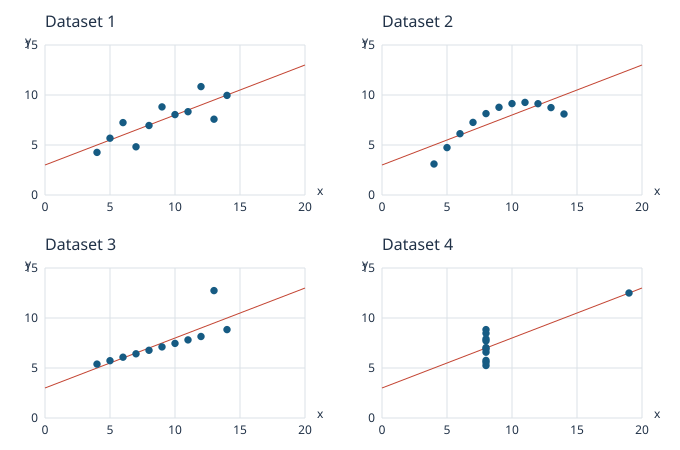

# 复现 Anscombe 四重奏

**问题**　四组观测得到几乎相同的直线与 R²，能否据此判断它们都适合用直线描述？运行前先画出你预计看到的四张图，再猜哪组删掉一个点后连斜率都无法估计。

**原始材料**　F. J. Anscombe，1973，*Graphs in Statistical Analysis*，第 3 节的数据表和图 1–4。`data.csv` 按论文表格录入，前三组共享 `x123`，第四组使用 `x4`。每组有 11 对观测。[原论文 DOI](https://doi.org/10.1080/00031305.1973.10478966) · [论文全文](https://garstats.wordpress.com/wp-content/uploads/2016/08/anscombe-as-1973.pdf) · [独立核对用的 R 数据说明](https://search.r-project.org/R/refmans/datasets/html/anscombe.html)

### P01 · 先定判据

用带截距的一元普通最小二乘独立实现。斜率取中心化交叉乘积之和除以 x 的离差平方和，截距由样本均值求出，R² 取 1 减残差平方和与 y 的总离差平方和之比。作者给出截距 3、斜率 0.5、R² 0.667。由于输入和报告值均有舍入，本练习采用绝对容差 0.005、0.001、0.001。这些容差是本次复现的判断标准。每组都要通过，并使用相同的坐标范围绘制四组观测和拟合线。

### R01 · 在仓库根目录运行

```sh
python examples/anscombe/reproduce.py
```

固定输入、确定性计算、无额外依赖。终端打印 Python 版本、输入 SHA-256 和判定。脚本同时生成 `output/figure.svg`。

| 组 | 截距 | 斜率 | R² |
|---|---:|---:|---:|
| 1 | 3.000091 | 0.500091 | 0.666542 |
| 2 | 3.000909 | 0.500000 | 0.666242 |
| 3 | 3.002455 | 0.499727 | 0.666324 |
| 4 | 3.001727 | 0.499909 | 0.666707 |

四组都落入 P01 容差。看图时具体找三处差别：第 2 组中段呈弧形；第 3 组有一点偏离其余近乎共线的点；第 4 组只有一个点的横坐标与其余点不同。

<details>
<summary>展开本次复现生成的四联图</summary>



</details>

### R02 · 检验作者对第 4 组的解释

删除 x=19 的唯一观测，余下十个点的 x 全部等于 8。脚本检查删点数和横坐标的唯一值数。此时斜率公式的分母为零，多条不同斜率的直线都能在 x=8 给出相同预测。删点实验重建了论文中的敏感性判断。

### 下一次自己做

先预测第 1 组逐点删除后的斜率范围，再写一段 leave-one-out 分析。把第 1、3、4 组并排列出，区分“斜率改变”和“斜率不可估计”。这是一个独立扩展。四组数据是人为构造的例子，能证明摘要统计量存在这种局限；它们没有给出这种情况在真实数据中的频率。
